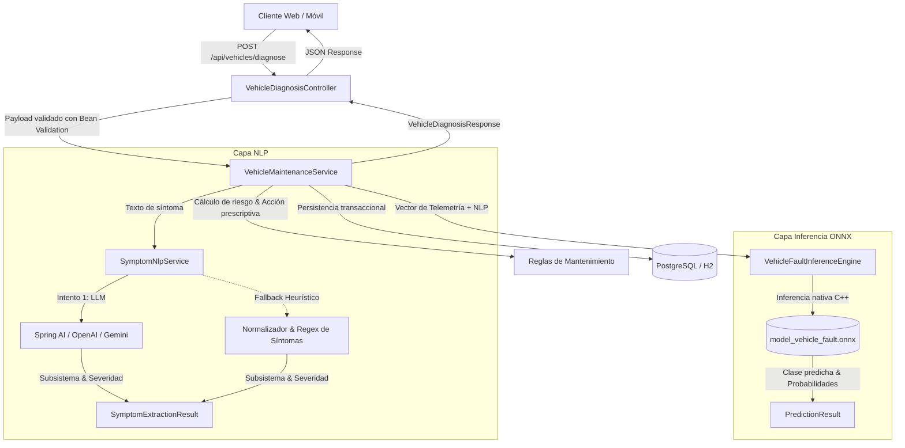

# 🚗 Sistema Predictivo de Mantenimiento y Fallas Vehiculares (Backend)

Backend empresarial desarrollado con **Spring Boot 3**, **ONNX Runtime** y **Procesamiento de Lenguaje Natural (NLP)** para el diagnóstico predictivo, preventivo y prescriptivo de anomalías mecánicas y eléctricas en vehículos automotores.

---

## 🏗️ Arquitectura del Sistema

El flujo de diagnóstico combina datos telemétricos del vehículo con la descripción cualitativa del conductor en lenguaje natural:



---

## 🚀 Tecnologías Empleadas

- **Lenguaje**: Java 21 (LTS)
- **Framework**: Spring Boot 3.4.2
- **Persistencia**: Spring Data JPA & Hibernate
- **Bases de Datos**:
  - PostgreSQL 16 (Entorno productivo / desarrollo con Docker)
  - H2 Database (Entorno de pruebas automatizadas en memoria)
- **Inteligencia Artificial / Machine Learning**:
  - **ONNX Runtime (Java)**: Inferencia de alto rendimiento en CPU
  - **Scikit-Learn & ONNX**: Entrenamiento de ensamble Random Forest en Python
  - **Spring AI**: Integración con modelos de lenguaje generativo
- **Testing**: JUnit 5, Mockito, Spring Boot Test
- **Herramientas de Construcción & DevOps**: Maven Wrapper (`mvnw`), Docker & Docker Compose

---

## 📊 Subsistemas Diagnosticados por el Modelo

| Código | Subsistema | Telemetría / Factores Clave |
| :---: | :--- | :--- |
| **0** | **Transmisión** | Vibración al acelerar, desgaste de embrague/clutch, kilometraje > 60,000 km |
| **1** | **Frenos** | Chirridos metálicos, pedal esponjoso, km desde último servicio > 12,000 km |
| **2** | **Suspensión** | Golpes secos en baches, amortiguadores fatigados, kilometraje > 70,000 km |
| **3** | **Motor** | Consumo de combustible anómalo (ratio > 1.30), humo, cascabeleo |
| **4** | **Eléctrico** | Testigos en tablero, batería descargada, fallas de alternador |
| **5** | **Normal** | Parámetros dentro de tolerancia y servicio reciente |

---

## ⚙️ Requisitos Previos

- **JDK 21** o superior instalado y configurado en el `PATH`
- **Docker Desktop** (opcional, para levantar la base de datos PostgreSQL)
- **Python 3.10+** (únicamente si se desea reentrenar el modelo de Machine Learning)

---

## 🛠️ Puesta en Marcha (Paso a Paso)

### 1. Iniciar Base de Datos con Docker Compose
```bash
docker compose up -d
```
Esto iniciará:
- **PostgreSQL** en el puerto `5432` (Base de datos: `vehiculos_db`, Usuario: `postgres`, Password: `1234`)
- **pgAdmin 4** en `http://localhost:5050` (Email: `admin@vehiculos.edu.co`, Password: `admin`)

### 2. Compilar y Ejecutar Pruebas Automatizadas
```bash
# En Windows (PowerShell / CMD)
.\mvnw.cmd clean test

# En Linux / macOS
./mvnw clean test
```

### 3. Iniciar el Servidor de Backend
```bash
# En Windows (PowerShell / CMD)
.\mvnw.cmd spring-boot:run

# En Linux / macOS
./mvnw spring-boot:run
```
El servidor escuchará en `http://localhost:8082`.

---

## 📡 Endpoints de la API REST

### 1. Estado y Monitoreo del Motor de Inferencia
- **GET** `/api/vehicles/health`
```json
{
  "status": "UP",
  "service": "Sistema Predictivo de Mantenimiento Vehicular",
  "inferenceEngine": "ONNX Runtime 1.20",
  "timestamp": "2026-10-14T12:00:00"
}
```

### 2. Diagnosticar Vehículo
- **POST** `/api/vehicles/diagnose`
- **Headers**: `Content-Type: application/json`

**Ejemplo de Petición:**
```json
{
  "licensePlate": "TRX-101",
  "mileageKm": 115000.0,
  "kmSinceLastService": 14500.0,
  "fuelConsumptionRatio": 1.15,
  "rawSymptomText": "Vibración excesiva al acelerar en tercera marcha y la palanca tironea"
}
```

**Ejemplo de Respuesta:**
```json
{
  "licensePlate": "TRX-101",
  "primaryFault": "Falla en Sistema de Transmisión",
  "confidencePercentage": 94.76,
  "riskLevel": "CRÍTICO",
  "recommendedAction": "Realizar inspección técnica prioritaria en taller de caja y transmisión: revisar nivel y calidad de aceite de transmisión (ATF/valvulina), estado de los discos de embrague (clutch), juntas homocinéticas y soportes de motor/caja.",
  "disclaimer": "Herramienta orientativa de apoyo, no sustituye un diagnóstico mecánico profesional."
}
```

### 3. Consultar Historial de Diagnósticos
- **GET** `/api/vehicles/history`: Retorna la lista histórica completa ordenada cronológicamente de forma descendente.
- **GET** `/api/vehicles/history/{licensePlate}`: Retorna el historial de auditorías para la placa indicada.

---

## 🤖 Entrenamiento y Exportación del Modelo (Python)

Si se desea ajustar los pesos o regenerar el dataset sintético de telemetría:

```bash
cd ml-model
python -m venv venv
.\venv\Scripts\activate
pip install numpy pandas scikit-learn skl2onnx onnxruntime
python train_vehicle_fault_model.py
```
El script generará el archivo `model_vehicle_fault.onnx` optimizado y validado en CPU. Copiar el archivo generado a `src/main/resources/models/model_vehicle_fault.onnx` si se reentrena.

---

## 🧪 Pruebas Automatizadas Incluidas

1. **`VehicleDiagnosisIntegrationTest`**:
   - Prueba integral de clasificación para fallas de transmisión.
   - Prueba integral de clasificación para fallas de frenos y cálculo de recomendaciones.
2. **`SymptomNlpServiceTest`**:
   - Pruebas unitarias de las reglas heurísticas y normalización para los 5 subsistemas vehiculares.
   - Verificación de severidad y tolerancia a cadenas vacías o nulas.
3. **`VehiculosBackendApplicationTests`**:
   - Verificación del levantamiento correcto del contexto de Spring Boot y beans inyectados.

---

## 📝 Notas Académicas
- **Asignatura**: Desarrollo Web
- **Semestre**: 7
- **Autor**: Ricardo Arias M.
